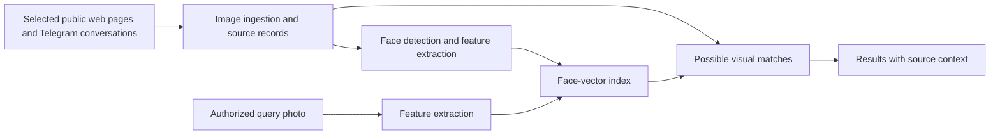

# PrivacyLeak

**Face search for checking possible exposure on publicly accessible adult-oriented sites and other indexed sources.**

[Try PrivacyLeak](https://privacyleak.ai/?utm_source=github&utm_medium=referral&utm_campaign=official_repo) · [How face search works](https://privacyleak.ai/reverse-image-search) · [Support](mailto:support@privacyleak.ai)

This is PrivacyLeak's product and technical overview. It is a documentation repository, **not** the source code of the production service. Search results are possible visual matches, not proof of identity, consent, or misuse.

## What you can do

Upload a clear photo that you own or are authorized to use. PrivacyLeak compares its facial features with an index of images collected from selected publicly accessible sources. Results show possible matches; available source details help you inspect where an image was found.

The current product offers **10 free searches**. Viewing full result details and source URLs requires a paid unlock. A search with no matches does not prove that an image is absent from the internet.

## Where the index comes from

| Source category | Images considered | Outside the stated scope |
| --- | --- | --- |
| Public websites, including publicly viewable pages on adult-oriented sites | Images already visible on selected public pages, such as photos, profile images, and video thumbnails | Content behind a login or paywall; the underlying video file |
| Public Telegram conversations | Publicly accessible image messages in selected public conversations | Private chats, private groups, or messages unavailable to the public |

Source selection and coverage change over time. We do not claim to index every adult website, every public Telegram conversation, or every image on a selected site. The source URL associated with a result identifies a page where the indexed image was observed; the page may subsequently change or disappear.

## How search works

The current implementation described in our technical documentation uses **InsightFace (`buffalo_l`)** with **ONNX Runtime** and **OpenCV** for face processing, **FAISS** for nearest-neighbor search, and **MySQL** for indexed records and source metadata. A **React/Vite** website and a **TypeScript/grammY** Telegram bot are query interfaces to the same face-search service. The Telegram ingestion workflow also uses **SQLite** as a local staging store before metadata synchronization.

These components describe the search workflow, not the size or completeness of the index. An uploaded query photo is processed to run the search and is not added to the public image index. PrivacyLeak retains result-related source URLs; it does not retain the user's uploaded query photo as a stored result image.

## How PrivacyLeak compares

This table compares the products' **published scope and use case**, not search quality or the number of matches. Different indexes can return different results for the same image.

| Tool | Published focus | Practical distinction |
| --- | --- | --- |
| **PrivacyLeak** | Face matching against selected public web sources, with an emphasis on possible exposure on adult-oriented sites and selected public Telegram conversations | Focused exposure check; website and Telegram bot; 10 free searches, then paid access to full result details and source URLs |
| [PimEyes](https://pimeyes.com/en/about-us) | Face search across publicly accessible websites; its published scope excludes social-media platforms | Broader open-web positioning; paid plans include source access and [alerts](https://pimeyes.com/en/terms-of-service) |
| [FaceCheck.ID](https://facecheck.id/en/Face-Search/FAQ) | Investigative face search across public web pages, with risk indicators for several source types, including adult content | Broader investigative workflow; similarity scores and risk flags |
| [lenso.ai](https://lenso.ai/en/page/face-search) | General visual search with People, Duplicates, Places, and other result categories | Combines face search with other image-search tasks; People availability can vary by region |
| [Google Lens](https://support.google.com/websearch/answer/1325808?hl=en) | General visual search for similar images, objects, and pages containing an image | Useful complementary image search; not a dedicated face-exposure workflow |

We do not claim that another service never finds adult-site results or that PrivacyLeak has greater coverage. The useful comparison is which sources and workflows a user needs, followed by a careful review of actual matches.

## Privacy and responsible use

- Search only with photos you own or are authorized to submit. Do not use the service to stalk, harass, or identify someone without a legitimate basis.
- A visually similar face is an investigative lead, not a verified identity match. Check the source page and context before drawing a conclusion.
- Private or restricted material is outside the source scope described here. No face-search engine has complete coverage of the public internet.
- PrivacyLeak cannot remove content from a third-party website merely by changing its own search results. For assistance with a specific result, contact [support](mailto:support@privacyleak.ai).

## Contact

Product: [privacyleak.ai](https://privacyleak.ai/)  
Support: [support@privacyleak.ai](mailto:support@privacyleak.ai)

<!-- Add a GitHub-only promotion here only after the code, price, eligibility, expiration, and redemption path have been configured and tested in production. -->
